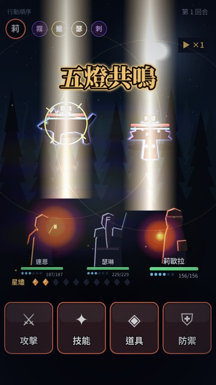
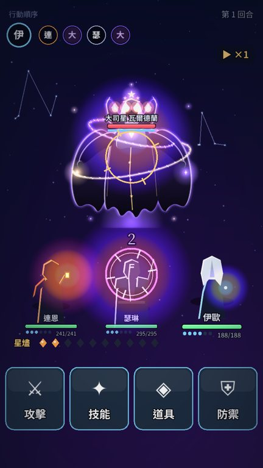
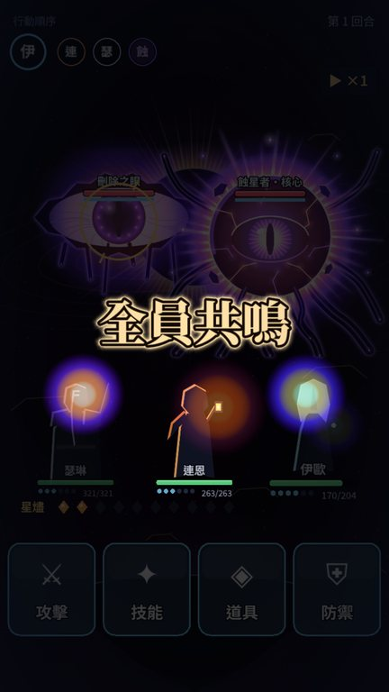
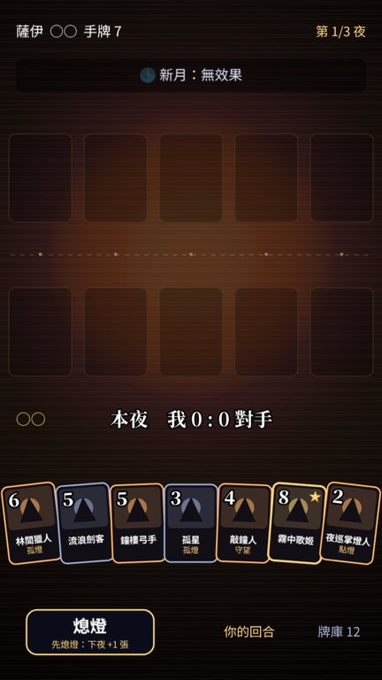
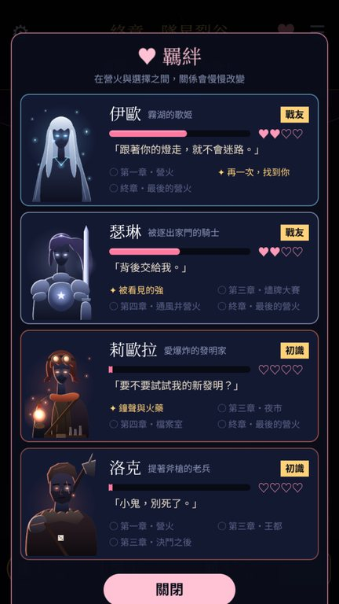
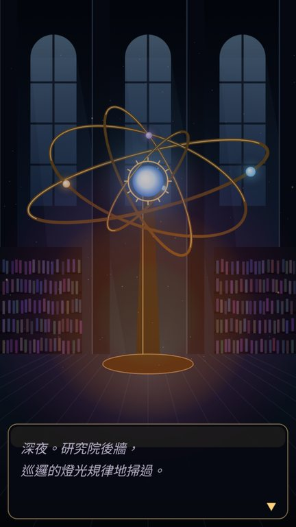
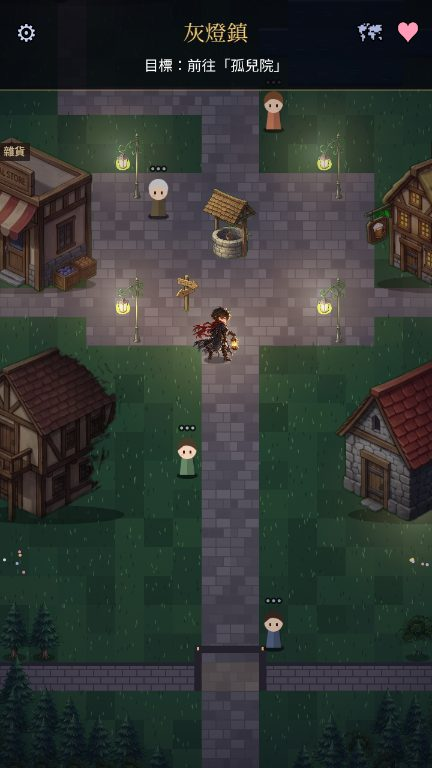
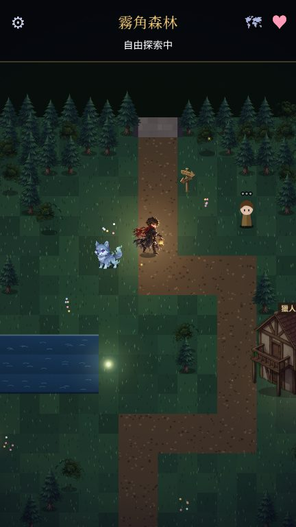
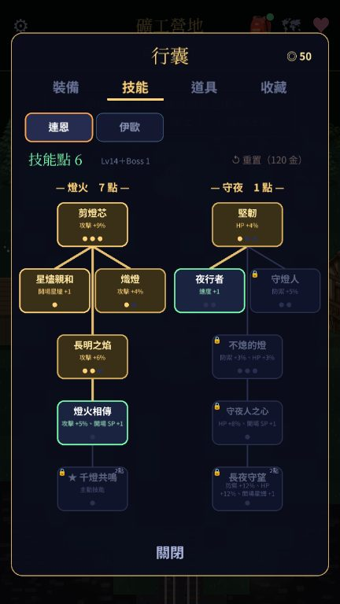
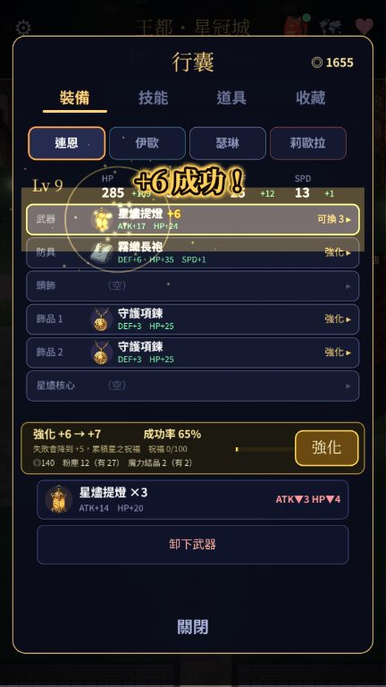

# 星燼回響 Echoes of Starfall

> 前世是冷門手遊的全成就玩家，轉生進那款遊戲的世界——他記得森林裡哪裡藏著寶箱、狼王撞上岩壁會暈、連續打倒幾群狼就會引出首領。

原創冒險 RPG，手機單機（iOS / Android / PWA），**完全離線**、直式單手操作。

🚧 **開發中**（2026-10-23 開工，11/05 成果發表）。進度見 [`docs/PROGRESS.md`](docs/PROGRESS.md)，計畫見 [`docs/PLAN.md`](docs/PLAN.md)。

## 兩種玩法
### ⚔️ 霧語森林・即時戰鬥（新方向，標題第二個按鈕）
- **一整張可以自由走的森林**（48×96 格、六個地區），整張地圖就是一場即時戰鬥：走過去、狼看到你就醒、直接開打，沒有切換戰鬥畫面，也沒有時間限制。
- **簡單但吃技巧**：左下搖桿或點地面移動，放開就自動追擊＋普攻；右下重斬、旋風斬、衝鋒、格擋反擊、閃避，打出傷害集滿 MP 放大招「劍刃風暴」。敵人出手前地上會出現紅色範圍，**由內往外填滿就命中**；黃框的攻擊可以格擋反擊。
- **越深越兇、也掉得越多**：南營地 → 森林入口 → 狼群巢穴／森林深處 → 精英狼群 → **霧角狼王**（兩階段、衝鋒撞岩壁會暈）。狼王打倒後離開巢穴會回來，可以一直挑戰、刷最快紀錄。
- **營火**：怪不追進火堆旁；點營火休息回滿、補藥水；倒下會在營火醒來。
- **遊戲記憶**：靠近隱藏寶箱會浮現「這個地方似乎有點熟悉……」；不倒下連殺 12 隻會引出隱藏首領；偶爾會有狼群暴動。
- **越刷越強**：打怪得經驗、升級立刻變強（金色光柱）；怪物會掉**裝備**（6 格：武器、頭盔、鎧甲、護手、戒指、項鍊；普通／精良／稀有，精良以上地上有光柱、帶隨機詞綴；稀有還有「重斬冷卻 −12%」這類技能特效），☰ → 行囊看「換上後攻擊 +12・HP +80」再決定；用不到的分解成粉塵，**在營火旁強化 +1～+10**（營火旁直接有「行囊・強化」按鈕）；每次進森林第一次打倒狼王保底稀有。實測普通 Bot 刷 30 分鐘後，同一隻狼王從約 170 秒打到約 90 秒。
- **獨立紀錄**：等級、行囊、累計擊殺、撿到的金幣與材料、開過的寶箱、狼王討伐次數與最快時間（不碰主線存檔）。
- **操作自訂**：拖曳調整每顆按鈕與搖桿的位置、交換技能欄、左手模式、按鈕大小、桌機改鍵（☰ → 操作設定）。

### 📖 星燼回響主線（第一版：回合制＋自由探索，可從序章玩到三結局）
- 自由走動的城鎮與野外（灰燈鎮、霧角森林、沉鐘礦坑、王都、墜星裂谷）、明雷戰鬥、商店與裝備、技能樹、稀有／神級掉落、強化 +10 與詞綴。
- 回合制＋時機輸入戰鬥（點擊格擋、滑動閃避、長按引路之光）、四位同伴的羈絆與約會、酒館卡牌小遊戲「燼牌」、三種結局與片尾旅程統計。
- 10/24 Jacky 決定改成即時動作戰鬥後，這一版**保留可玩、不再加新功能**。

## 畫面

| 霧語森林（即時戰鬥大地圖） | 即時戰鬥：霧角狼王 | 預告＋格擋反擊 |
|:-:|:-:|:-:|
|  |  |  |
| **營火（怪不追進來、休息與復活）** | **繞石尋路、拉怪、大招與藥水** | **標題** |
|  |  |  |
| **新：行囊（裝備比較、▲ 比較好）** | **新：等級提升** | **新：操作設定（改鍵、左手、按鈕位置）** |
|  |  |  |

<details><summary>主線第一版（回合制）的畫面</summary>

| | | |
|:-:|:-:|:-:|
|  |  |  |
|  |  |  |
|  |  |  |
|  |  |  |

</details>

> 音效、音樂全部程式即時生成（WebAudio），repo 裡沒有音訊素材檔。圖片：主要角色立繪、Q 版戰鬥圖、標題主視覺、Boss、小怪、地圖物件與道具圖示由 Jacky 用 AI 繪圖產生（`public/art/`，需求清單見 `docs/ART_REQUESTS.md`）；地面、樹林、光影、粒子、配角立繪等是程式繪製，每張 AI 圖都有程式備援。

## 怎麼玩
- **PWA（任何手機瀏覽器）**：https://twjackysu.github.io/JackyGame/ 
  - iOS Safari：分享 → 加入主畫面；Android Chrome：選單 → 安裝應用程式。之後可離線遊玩。
  - 標題「霧語森林・即時戰鬥」進新玩法；「新的旅程」是主線第一版。
- **Android APK**：[Releases → latest](https://github.com/twjackysu/JackyGame/releases/tag/latest) 下載 `jackygame-debug.apk`，允許「安裝未知來源應用程式」後安裝。
- **iOS（原生，需 Mac）**：
  1. 安裝 Xcode、Node 22+。
  2. `npm ci && npm run build && npx cap sync ios && npx cap open ios`
  3. Xcode → Signing & Capabilities → Team 選你的（免費）Apple ID，Bundle ID 若衝突就改一個。
  4. 接上 iPhone，按 ▶︎ 執行。iPhone 上到「設定 → 一般 → VPN 與裝置管理」信任開發者。免費帳號簽署 7 天有效。
- 開發用試玩小關卡：`?debug&scene=RtBattle&stage=wolf_king`（`forest_entry`／`wolf_den`／`forest_deep`／`elite_pack`／`rock_grove`／`camp_clearing`，☰ 可換關；加 `&bot=expert` 看 Bot 自己打）。

## 開發日誌
| 輪次 | 台北時間 | 重點 |
|:-:|---|---|
| 1 | 10/23 22:19 | 市場調查、世界觀、設計文件 01–10 定稿；Vite + Phaser + PWA + Capacitor 骨架；CI／Pages／APK 管線 |
| 2 | 10/24 00:14 | 戰鬥場景（時機光環、三種防守手勢、共鳴演出）、對話、地圖、燼牌 UI；序章＋第 1 章可玩 |
| 3 | 10/24 02:13 | 自動通關機器人、修致命軟鎖；設定面板、BGM；第 2 章「沉鐘」 |
| 4 | 10/24 06:12 | 第 3、4、終章完成，**全劇情可玩到三結局**；同伴技能與連攜技 |
| 5 | 10/24 08:12 | 每隻 Boss 的特殊機制、終局全員共鳴、羈絆面板、片尾旅程統計 |
| 6 | 10/24 10:12 | 成果發表截圖、新手引導、燼牌專屬紋章與收藏入牌組、二週目、勝利戰績、省電畫質（低 FPS 自動）、共鳴相機 bug 修正 |
| 7 | 10/24 12:12 | 回應業主「人物太醜」：接上 Jacky 提供的 6 張主要角色立繪；14 位配角改為**動漫風程式立繪**（賽璐珞陰影、邊緣光、大眼高光），戰鬥背影同步重畫，標題加主視覺 |
| 8 | 10/24 14:12 | **改版為自由探索**：探索引擎（點擊尋路、虛擬搖桿、同伴跟隨、NPC 閒晃）、**第 1 章三個可走區域**（灰燈鎮、霧角森林、狼徑・古燈塔）、明雷戰鬥；匯入 Jacky 的 AI 美術（標題主視覺、Boss、小怪、地圖物件、道具） |
| 9 | 10/24 16:11 | **商店與裝備、技能樹、營火羈絆**（聊天＋送禮）；第 1 章支線「霧菇與紅頭巾」（護送米亞）、「流浪牌手」；等級差小怪逃跑；**第 2～終章全部可走**（礦工營地、沉鐘礦坑：岩壁／軌道／發光礦晶；王都・星冠城；研究院地下；墜星裂谷） |
| 10 | 10/24 18:12 | Jacky 新指示：**稀有／神級掉落**（掉落表、Boss 首殺、神級特效、卡片光柱演出、收藏頁）；**技能樹 v2**（前置＋分支點數門檻＋5 個奧義主動技能）；有裝備後重新平衡 Boss；地圖裝飾物件＋隱藏寶箱；**城鎮約會事件** ×4 |
| 11 | 10/24 20:12 | **長尾刷寶地基**（Jacky 拍板的暗黑／RO 式方向）：可重現的分流亂數、**每件裝備獨立實例**（之後可強化、帶詞綴）＋存檔自動升級、**6 格裝備**（頭飾、雙飾品、星燼核心）、可搬到伺服器的 `GameApi`（買賣、寶箱、掉落都經它並記事件）；**效果觸發框架**（含防無限循環）、**強化 +10**（10 萬次模擬校準：P99 從 200 次降到 34 次）、21 條隨機詞綴與保底、重鑄、分解 |
| 12 | 10/24 22:12 | **長尾刷寶「摸得到」**：強化 UI（金光／灰煙演出、祝福條）、分解與上鎖、主線戰鬥掉材料、稀有掉落帶詞綴並算進數值、三層裝備 UI（先看詳情再換上、稀有度外框）。同一時間 Jacky 拍板改成**單人即時動作戰鬥**（D-062／063／065），當輪就做出**即時戰鬥核心第一版**（純 TS、30 ticks/秒、可重現、劍士四技能＋閃避、敵人範圍預告、霧角狼王兩階段、五個原型關卡、四種操作模型的 Bot 與無畫面模擬器）；畫面接入等 Jacky 試玩決定 |
| 13 | 10/25 00:12 | **即時戰鬥試玩打磨**：鏡頭跟隨、Q 版立繪、預告由內往外填滿、刀光與命中停頓、Boss 血條、☰ 選單（換關、Bot 示範）；核心加入**大招劍刃風暴＋MP 回復**與 **HP 藥水**（先進模擬器，試玩鍵位待 Jacky 回覆） |
| 14 | 10/25 02:11 | **即時戰鬥往地圖化前進**：格子 A* 尋路與視線（狼會繞石頭、射手隔石不射、隔石衝鋒會撞暈）、**點地移動**、地圖怪「看到才醒、同伴連鎖、追太遠回家回滿」、脫戰自然恢復、流場讓大地圖追擊快 100 倍；新試玩關**碎石林道**；試玩鍵位加上**大招劍刃風暴**（MP 環＋演出）與**藥水** |
| 15 | 10/25 04:11 | **刷怪循環的骨架**：怪物**重生點**、**營火**（怪不追進來、休息回滿補藥水、倒下在營火醒來）、同時追擊上限 8 與遠處怪物沉睡（大地圖 200 隻怪每 tick < 0.5ms）、Bot 學會「一次只拉一組」、Boss 跑出巢穴會重置、**地上會掉金幣與強化材料**（走近自動撿，撿越多武器越強）；新試玩關**營火空地**（5 分鐘能打倒幾隻？）、點地移動路徑預覽；CI 截圖逾時修正 |
| 16 | 10/25 06:12 | **大地圖的畫面準備**：地面分塊烘焙（修好地面偏 8px）、成片障礙自動畫成**樹林**、**小地圖**（點了就走過去）、地區名稱橫幅、精英／Boss 距離箭頭；關卡資料檢查 `validateStage`；**霧語森林 48×96 版面草稿**（design/22） |
| 17 | 10/25 08:12 | **霧語森林接成真的大地圖**（除錯入口）：48×96 六個地區、七個重生點（越深越強、掉得越多）、兩個營火、**狼王打倒後離開巢穴會回來可再挑戰**、**狼群暴動**事件、四個**隱藏寶箱**（靠近才浮現「這個地方似乎有點熟悉……」）、HUD 目標列與討伐演出；修好被擊退卡進樹林的問題 |
| 18 | 10/25 10:12 | Jacky 試玩回覆後：**霧語森林開放標題入口**（無縫、沒有時間限制、獨立紀錄）、**操作自訂**（拖曳按鈕位置、交換技能、左手模式、大小、桌機改鍵）、**P4 刷寶第一版**：經驗值與等級、裝備掉落（6 格、三種稀有度、詞綴、光柱）、行囊比較與換裝、營火強化 +10 與分解；整理過時文件 |

**統計**（2026-10-25 第 18 輪）：執行 18 輪、約 290 個 commit、579 項自動測試、TypeScript 約 3.2 萬行、62 張 AI 美術圖、0 個音訊素材檔。

## 開發
```bash
npm ci            # 需 Node 22.12+
npm run dev       # 開發伺服器
npm test          # vitest
npm run build     # typecheck + 產出 dist/
npm run screenshot  # Playwright 截圖（需先 build）
```
技術：TypeScript、Vite、Phaser 3、vite-plugin-pwa、Capacitor 8。美術與音效全部程式生成。

## 文件
- 設計：[`docs/design/`](docs/design/)
- 決策：[`docs/DECISIONS.md`](docs/DECISIONS.md)

## 授權
GPL-3.0，見 [LICENSE](LICENSE)。
