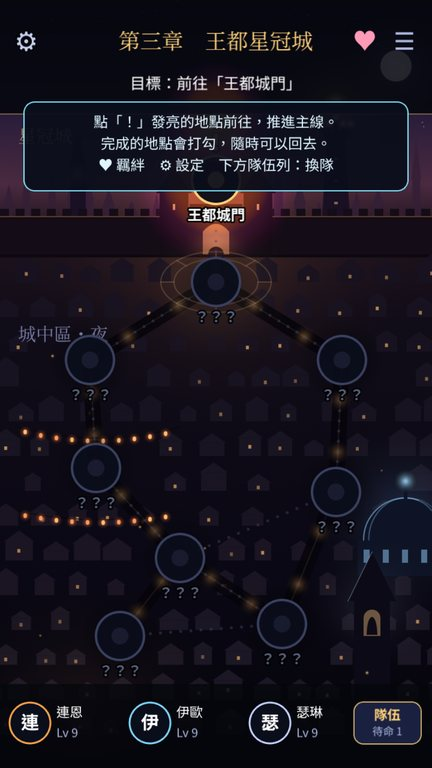
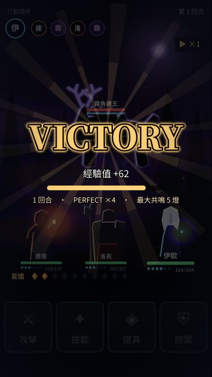
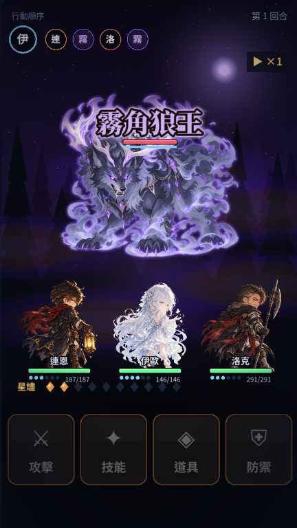
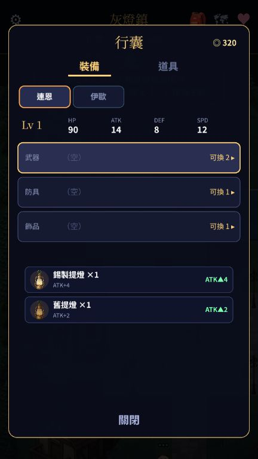
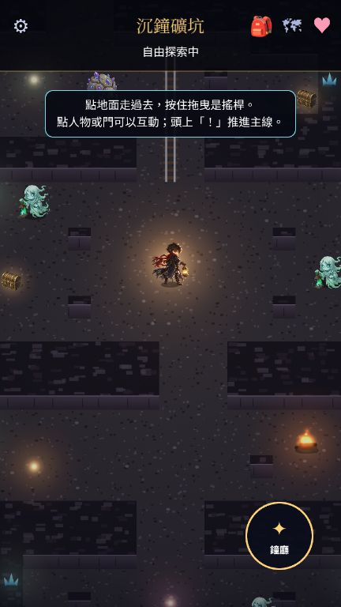
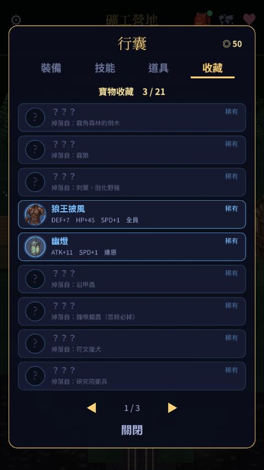

# 星燼回響 Echoes of Starfall

> 前世是冷門手遊的全成就玩家，轉生成開場就被騎士團遠征隊丟在遺跡裡的「掌燈人」——只有他知道，這個被當成提燈雜役的職業是全遊戲最強的隱藏職業。

原創冒險 RPG，手機單機（iOS / Android / PWA），**完全離線**、直式單手操作。

🚧 **開發中**（2026-10-23 開工，11/05 成果發表）。主線已可從序章一路玩到終章三結局。進度見 [`docs/PROGRESS.md`](docs/PROGRESS.md)，計畫見 [`docs/PLAN.md`](docs/PLAN.md)。

> 🧭 **10/24 起改版方向**：自由走動探索的經典 RPG（點擊移動、NPC 觸發劇情、商店裝備、技能搭配、自由戀愛線），見 [`docs/design/11-open-world.md`](docs/design/11-open-world.md)。

## 畫面

| 標題 | 章節地圖 | 時機光環 |
|:-:|:-:|:-:|
|  |  |  |
| **五燈共鳴** | **Boss：星空舞台** | **終局：全員共鳴** |
|  |  |  |
| **燼牌（卡牌小遊戲）** | **同伴羈絆** | **劇情對話** |
|  |  |  |
| **勝利與戰績** | **自由探索：灰燈鎮** | **自由探索：霧角森林（明雷）** |
|  |  |  |
| **Boss：霧角狼王** | **商店：買賣與直接換裝** | **行囊：裝備比較** |
|  |  |  |
| **自由探索：沉鐘礦坑** | **技能樹（前置＋門檻＋奧義）** | **寶物收藏（稀有／神級掉落）** |
|  |  |  |

> 音效、音樂全部程式即時生成（WebAudio），repo 裡沒有音訊素材檔。圖片：主要角色立繪、Q 版戰鬥圖、標題主視覺、Boss、小怪、地圖物件與道具圖示由 Jacky 用 AI 繪圖產生（`public/art/`，需求清單見 `docs/ART_REQUESTS.md`）；地面圖塊、裝飾物件、光影、粒子、配角立繪等仍是程式繪製（`src/game/art/`），每張 AI 圖都有程式備援。


## 目前可以玩到（2026-10-24）
- 標題 →「新的旅程」：序章對話（屬性檢定、攻略筆記選項、星形骰）→ 教學戰（燈印 + 共鳴）→ 第 1 章節點地圖 → 各地點劇情、戰鬥、燼牌對局、雜貨店 → 狼王 Boss → 章節結算。自動存檔，「繼續旅程」可接續。
- **第 2 章「沉鐘」**：瑟琳、莉歐拉加入，礦坑地圖、「告訴瑟琳未來」分歧、鐘喉蠕蟲 Boss（四連鐘響、吞噬星燼）、隊伍編成。
- **第 3 章「星冠」**：王都、燼牌大賽三連戰、洛克的背叛與「攻略筆記燃燒」、鐘塔屋頂的說服決鬥。同伴技能與連攜技（燈下斬、燈火雷管）。
- **第 4 章「星核」與終章「燈火」**：研究院地下、伊歐的真相、大司星瓦爾德蘭（階段 2「星空舞台」：反燈印倒數引爆，要用引路之光淨化）；墜星裂谷、心之約定、蝕星者兩段戰（吞噬記憶封印技能 → 刪除之眼 → 「全員共鳴」十燈引爆），三種結局、後日談與片尾旅程統計。
- **自由探索（全部章節）**：灰燈鎮、霧角森林、狼徑・古燈塔、礦工營地、沉鐘礦坑、王都・星冠城、星術研究院地下、墜星裂谷都能自由走，同伴會在路上冒一句話；明雷戰鬥（背後偷襲先制、等級差太大小怪會逃）、寶箱、支線（廣場四盞燈、霧菇與紅頭巾、流浪牌手）。
- **商店與裝備**：22 件商店裝備（角色限定）、商店買賣（賣價半價）、行囊選單換裝、戰鬥吃裝備數值。
- **稀有／神級掉落**：16 件稀有（藍光）＋5 件神級（金光，帶「疾影」「不滅」「先燃」等特效）買不到，只能打怪低機率掉落、Boss 首殺必掉、或找到走近才現形的隱藏寶箱；勝利時卡片翻開＋光柱演出，行囊「收藏」頁顯示還缺哪件、從哪裡掉。
- **技能樹**：每人兩條分支 × 6 節點的樹，多等級節點、前置節點與「此分支要先投入幾點」的門檻；最深處是 5 個新主動技能（千燈共鳴、破曉一閃、梭哈、星之搖籃曲、連鎖大爆破）。升級和 Boss 首殺給點數，營火旁免費重置。
- **營火羈絆與約會**：在營火找同伴聊天（話題隨好感解鎖）、送禮（每人喜好不同）；好感夠高時城鎮裡會出現頭上「♥」的同伴，觸發約會事件。
- 「戰鬥演示」：森林 ×2 → 野豬 → 霧角狼王連戰；「燼牌演示」：直接開一局燼牌。

## 賣點（設計目標）
- **簡單但吃技巧的戰鬥**：回合制 + 時機輸入（點擊格擋、滑動閃避、長按引路之光），完美判定有打擊停頓、慢動作與光爆。
- **「廢職業」的隱藏玩法**：在敵人身上佈下燈印，一口氣共鳴引爆。
- **攻略知識 = 遊戲機制**：用前世記憶直接通過檢定，但會讓世界偏離劇本，情報逐漸失準。
- **同伴羈絆**：4 位同伴各有個人劇情與羈絆事件（全年齡）。
- **燼牌**：三夜制的酒館卡牌小遊戲，可收集、組牌。
- **選擇與後果**：屬性檢定、聲望、延遲回收的選擇、多結局。

## 怎麼玩
- **PWA（任何手機瀏覽器）**：https://twjackysu.github.io/JackyGame/ 
  - iOS Safari：分享 → 加入主畫面；Android Chrome：選單 → 安裝應用程式。之後可離線遊玩。
- **Android APK**：[Releases → latest](https://github.com/twjackysu/JackyGame/releases/tag/latest) 下載 `jackygame-debug.apk`，允許「安裝未知來源應用程式」後安裝。
- **iOS（原生，需 Mac）**：
  1. 安裝 Xcode、Node 22+。
  2. `npm ci && npm run build && npx cap sync ios && npx cap open ios`
  3. Xcode → Signing & Capabilities → Team 選你的（免費）Apple ID，Bundle ID 若衝突就改一個。
  4. 接上 iPhone，按 ▶︎ 執行。iPhone 上到「設定 → 一般 → VPN 與裝置管理」信任開發者。免費帳號簽署 7 天有效。

## 開發日誌
| 輪次 | 台北時間 | 重點 |
|:-:|---|---|
| 1 | 10/23 22:19 | 市場調查、世界觀、設計文件 01–10 定稿；Vite + Phaser + PWA + Capacitor 骨架；CI／Pages／APK 管線 |
| 2 | 10/24 00:14 | 戰鬥場景（時機光環、三種防守手勢、共鳴演出）、對話、地圖、燼牌 UI；序章＋第 1 章可玩 |
| 3 | 10/24 02:13 | 自動通關機器人、修致命軟鎖；設定面板、BGM；第 2 章「沉鐘」 |
| 4 | 10/24 06:12 | 第 3、4、終章完成，**全劇情可玩到三結局**；同伴技能與連攜技 |
| 5 | 10/24 08:12 | 每隻 Boss 的特殊機制、終局全員共鳴、羈絆面板、片尾旅程統計 |
| 6 | 10/24 10:12 | 成果發表截圖、新手引導、燼牌專屬紋章與收藏入牌組、二週目、勝利戰績、省電畫質（低 FPS 自動）、共鳴相機 bug 修正 |
| 7 | 10/24 12:12 | 回應業主「人物太醜」：接上 Jacky 提供的 6 張主要角色立繪；14 位配角改為**動漫風程式立繪**（賽璐珞陰影、邊緣光、大眼高光），戰鬥背影同步重畫，標題加主視覺 |
| 8 | 10/24 14:12 | **改版為自由探索**：探索引擎（點擊尋路、虛擬搖桿、同伴跟隨、NPC 閒晃）、**第 1 章三個可走區域**（灰燈鎮、霧角森林、狼徑・古燈塔）、明雷戰鬥；匯入 Jacky 的 AI 美術（標題主視覺、Boss、小怪、地圖物件、道具） |
| 9 | 10/24 16:11 | **商店與裝備、技能樹、營火羈絆**（聊天＋送禮）；第 1 章支線「霧菇與紅頭巾」（護送米亞）、「流浪牌手」；等級差小怪逃跑；**第 2～終章全部可走**（礦工營地、沉鐘礦坑：岩壁／軌道／發光礦晶；王都・星冠城；研究院地下；墜星裂谷） |
| 10 | 10/24 18:12 | Jacky 新指示：**稀有／神級掉落**（掉落表、Boss 首殺、神級特效、卡片光柱演出、收藏頁）；**技能樹 v2**（前置＋分支點數門檻＋5 個奧義主動技能）；有裝備後重新平衡 Boss；地圖裝飾物件＋隱藏寶箱；**城鎮約會事件** ×4 |

**統計**（2026-10-24 第 10 輪）：執行 10 輪、約 137 個 commit、305 項自動測試、TypeScript 約 2.4 萬行、62 張 AI 美術圖、0 個音訊素材檔。

## 開發
```bash
npm ci            # 需 Node 22.12+
npm run dev       # 開發伺服器
npm test          # vitest
npm run build     # typecheck + 產出 dist/
npm run screenshot  # Playwright 截圖（需先 build）
```
技術：TypeScript、Vite、Phaser 3、vite-plugin-pwa、Capacitor 8。美術與音效全部程式生成。

## 文件
- 設計：[`docs/design/`](docs/design/)
- 決策：[`docs/DECISIONS.md`](docs/DECISIONS.md)

## 授權
GPL-3.0，見 [LICENSE](LICENSE)。
