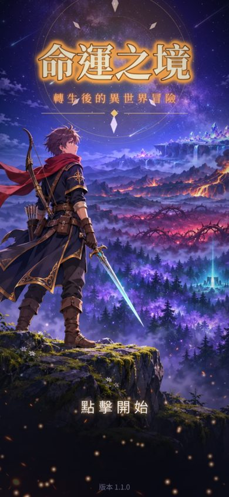
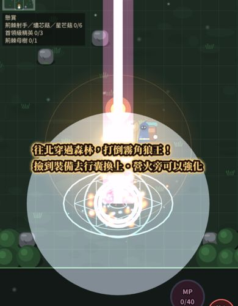
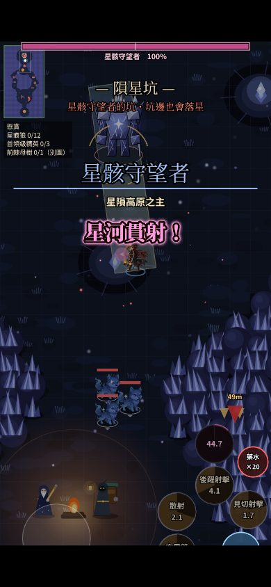
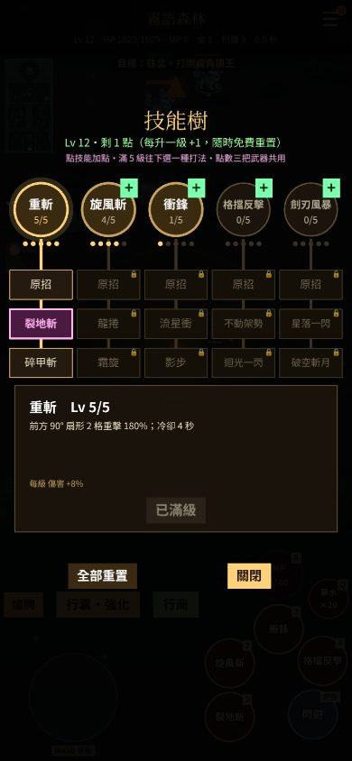
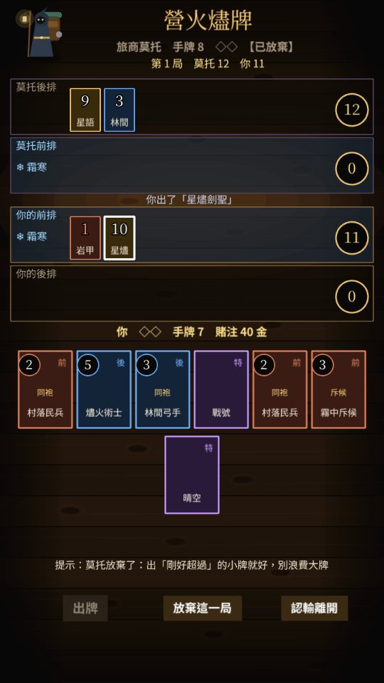

# 命運之境：轉生後的異世界冒險

*Realm of Fate — Reborn in Another World*

<p align="center"></p>

> 前世是冷門手遊《星燼回響》唯一的全成就玩家，醒來就在那款遊戲的營火旁——他記得哪裡藏著寶箱、狼王撞上岩壁會暈。

原創冒險 RPG・手機單機（iOS／Android／PWA）・**完全離線**・直式單手・即時動作戰鬥。

**▶ 馬上玩**：[網頁版（可加入主畫面）](https://twjackysu.github.io/JackyGame/)・[Android APK](https://github.com/twjackysu/JackyGame/releases/tag/latest)・[iOS 安裝](#安裝)

**📖 [遊戲 Wiki](docs/wiki/README.md)**：[強化](docs/wiki/enhance.md)・[技能樹](docs/wiki/skills.md)・[裝備與神裝](docs/wiki/gear.md)・[怪物與掉落](docs/wiki/monsters.md)・[畫面集](docs/wiki/gallery.md)・[交易與競技場](docs/wiki/online.md)

| 隕星術 | 星骸守望者 | 技能樹 | 營火燼牌 |
|:-:|:-:|:-:|:-:|
|  |  |  |  |

## 特色
- **自由走的四張大地圖**：霧語森林 → 荊棘谷 → 燼紅裂谷（結局）→ 通關後的星隕高原。整張地圖就是一場無縫戰鬥，打倒 Boss 後走進光門前往下一張。
- **簡單但吃技巧**：搖桿走路、放開自動攻擊；紅色預告閃開、黃框攻擊格擋反擊。三把武器（長劍／長弓／法杖）隨時切換。
- **越刷越強**：6 格裝備與詞綴、營火強化 +10、技能樹（每招三種打法）、行商自由買賣、暴怒 Boss 與深夜模式。
- **營火燼牌**：昆特牌風格三局兩勝卡牌小遊戲，五位對手，贏牌組牌。
- **選擇與後果**：Boss 倒下後「取」或「還」、路上的人「取」或「助」，行商價格、同伴、結局都會跟著變。
- **手機優先**：自動存檔、長螢幕填滿、按鈕位置可自訂；音效與音樂全部程式即時生成。電腦也能玩（WASD、1～4、空白閃避）。

## 第二期：交易與競技場（1.2.0）
- **拍賣所與面對面交易**：營火行商裡跟其他冒險者買賣裝備（單機版是 30 個模擬冒險者，上線後換成真人）。
- **競技場天梯**：非同步 PvP，伺服器用同一份引擎重跑你的操作判勝負；指名挑戰、復仇、連勝、段位光環。
- **多角色＋共用倉庫**。
- **單機模擬線上版**：遊戲內建一台權威伺服器，畫面只用 JSON 跟它講話；換掉資料庫連線字串與後端網址就能上線（Node.js＋Azure Container Apps＋Azure SQL）。架構圖、防作弊設計見 [Wiki：交易・競技場・線上化](docs/wiki/online.md)，部署見 [`docs/DEPLOY_AZURE.md`](docs/DEPLOY_AZURE.md)。

## 十分鐘上手
1. 點擊開始 → 看完序章 → 選武器（長劍最好上手）。
2. 往北走，打狼升級；升級後 ☰ → **技能樹**點技能，撿到裝備打開「行囊」換上。
3. 在**營火旁**休息、強化、找旅商莫托買賣或打燼牌。
4. 打倒霧角狼王（牠衝鋒撞牆會暈），選「取」或「還」，走進光門。
5. 一路打到燼心岩王就是結局（約 1 小時）；通關後還有星隕高原。

## 安裝
- **網頁／PWA**：手機開 https://twjackysu.github.io/JackyGame/ ，iOS Safari「分享 → 加入主畫面」、Android Chrome「安裝應用程式」，之後可離線玩。
- **Android**：[Releases → latest](https://github.com/twjackysu/JackyGame/releases/tag/latest) 下載 `jackygame-debug.apk` 安裝（1.1.0 起可直接覆蓋更新）。
- **iOS（需 Mac）**：`npm ci && npm run build && npx cap sync ios && npx cap open ios` → Xcode 選自己的 Apple ID Team → 接 iPhone 按 ▶︎；iPhone 上到「設定 → 一般 → VPN 與裝置管理」信任開發者（iOS 16+ 另需開「開發者模式」）。免費帳號 7 天要重簽。

## 開發
```bash
npm ci && npm run dev   # Node 22.12+
npm test                # vitest
npm run build           # typecheck + dist/
npm run playthrough     # 通關機器人
npm run wiki            # 由遊戲資料重新產生 docs/wiki
```
TypeScript・Vite・Phaser 3・vite-plugin-pwa・Capacitor 8。戰鬥核心是純 TypeScript（`src/core/battle/rt/`），畫面層在 `src/game/`。

由 Claude 以每 2 小時一輪的排程開發迴圈從零做出：2026-10-23 開工、約 140 輪、1150+ commits、TypeScript 約 2 萬行、410+ 項自動測試。
設計 [`docs/design/`](docs/design/README.md)・決策 [`docs/DECISIONS.md`](docs/DECISIONS.md)・開發紀錄 [`docs/PROGRESS.md`](docs/PROGRESS.md)・美術需求 [`docs/ART_REQUESTS.md`](docs/ART_REQUESTS.md)

## 授權
GPL-3.0，見 [LICENSE](LICENSE)。標題主視覺與角色、怪物圖由 Jacky 用 AI 繪圖產生（`public/art/`）。
