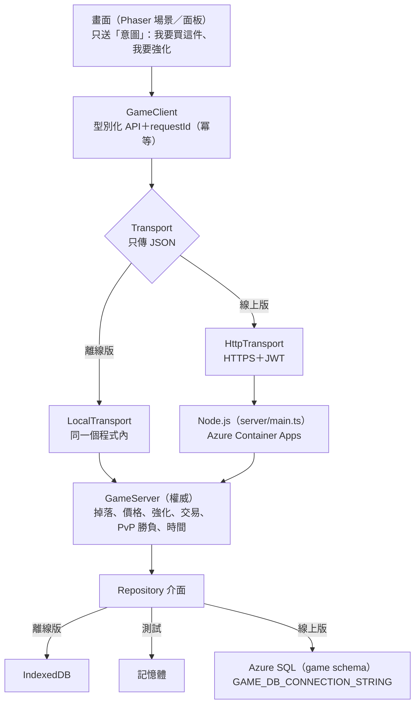

# 交易・競技場・線上化（第二期）

> 回 [Wiki 首頁](README.md)・[README](../../README.md)。部署步驟在 [`docs/DEPLOY_AZURE.md`](../DEPLOY_AZURE.md)，架構規格在 [`docs/design/24-online-architecture.md`](../design/24-online-architecture.md)、資安在 [`26-security.md`](../design/26-security.md)。

## 玩家看得到的
| 功能 | 在哪裡 | 重點 |
|---|---|---|
| **拍賣所** | 營火「行商」→「拍賣所」 | 30 個模擬冒險者會上架、殺價、買你的貨；上架費 1%、成交手續費 5%；你不在時賣掉的會在下次打開時通知（金幣飛進錢包）；上架時看得到同部位同稀有度「最近成交」的中位價，點一下就用它定價 |
| **面對面交易** | 營火「行商」→「交易」 | 託管式：雙方放進去的東西先由伺服器保管，兩邊都鎖定、對同一個版本按確認才交換 |
| **競技場天梯** | 標題「競技場」 | 非同步 PvP：伺服器挑對手、發種子，你打完把操作紀錄交回去，伺服器用同一份引擎重跑判勝負（做不了假）；段位分 Elo、指名挑戰（分差 200 內）、輸了「⚔ 再挑一次」、最近 5 場戰績、今日首勝與連勝、**每週賽季**（台北週一換季，記本季／上季最高段位，不重置分數、只給稱號；上季到過的段位，這季冒險時腳下光環照樣有）；荊棘段位以上冒險時腳下有段位光環；對手的配裝跟著分數走（分數低的對手裝備也差，1250 分以上的對手會帶強化）|
| **多角色＋共用倉庫** | 標題「角色」 | 3 個角色欄、倉庫 40 格，金幣分角色 |

PvP 獎勵只有段位稱號與外觀，不給數值。

## 架構：換掉連線字串／後端就能上線
遊戲裡現在就有一台「伺服器」，只是跑在手機裡；畫面只透過 JSON 訊息跟它講話。

- **同一份規則**：戰鬥引擎與經濟規則在 `src/core`（純 TypeScript、確定性亂數），伺服器和畫面共用；伺服器用它重跑 PvP、驗證掉落上限。
- **同一組測試**：`tests/server-contract/` 對記憶體、IndexedDB 兩種本機資料庫跑，CI 再對 SQL Server 2022 容器跑。
- **上線只換**：資料庫實作（`GAME_DB_CONNECTION_STRING`）、傳輸層（`ONLINE_API_URL`）、登入（Entra External ID）、模擬玩家換成真人。

## 防作弊（26-security）
- 客戶端只送意圖；金幣、物品 id、掉落擲骰、強化成敗、經驗、PvP 勝負、時間都由伺服器決定。
- 每個參數都驗 schema；SQL 全部參數化（Kysely）；每個請求檢查資源擁有權（別人的角色碰不到）。
- 寫入帶 requestId（網路重送不會買兩次）；交易類每秒限次；敏感動作被拒時寫稽核紀錄。
- 打怪的「我拿到了」有規則算得出的上限（重生點、Boss 重生時間、暴動），超過整筆拒絕。
- 線上版建置（`build:online`）不打包 `src/server`；線上帳號從新開始，離線存檔不能匯入。
